<!-- Generated by scripts/build.ts. Edit the data there, not this file. -->

<a href="https://www.balanceview.in/it-services">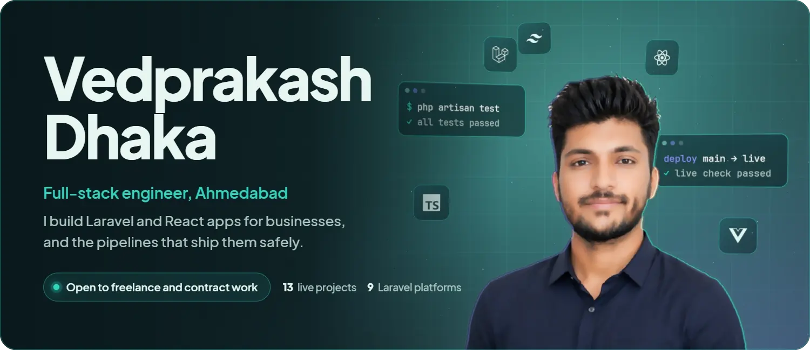</a>

Full-stack engineer in Ahmedabad. I build Laravel and React apps for businesses, with Filament back offices, and the CI pipelines that ship them safely. Open to freelance and contract work.

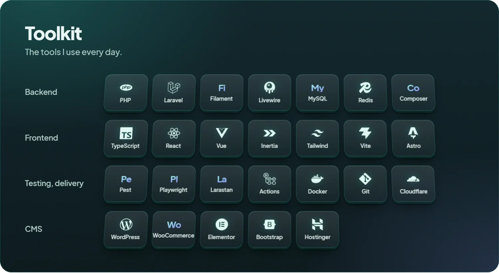

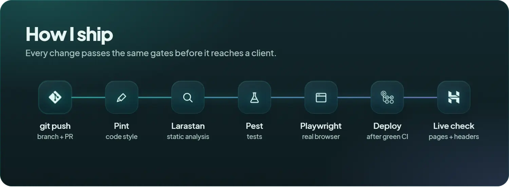

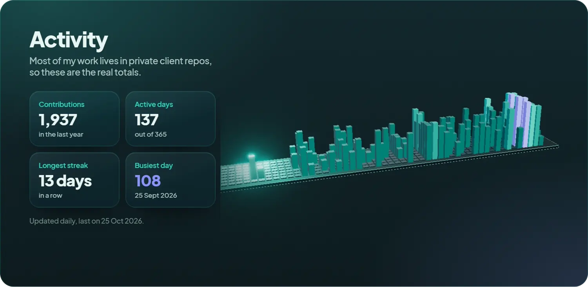

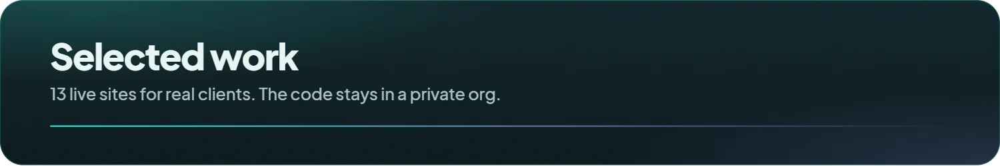

<a href="https://www.balanceview.in">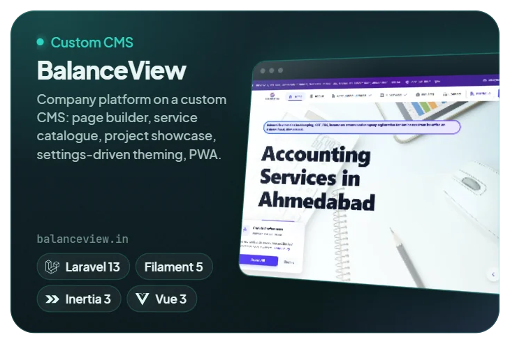</a><a href="https://www.panchalinterior.in">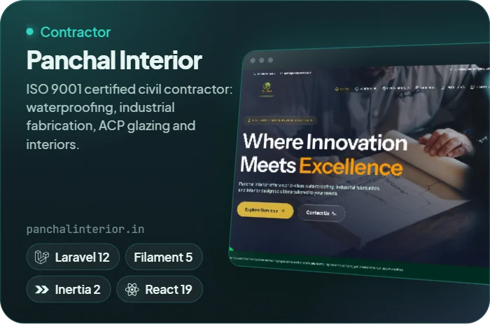</a> <a href="https://superfast.balanceview.in">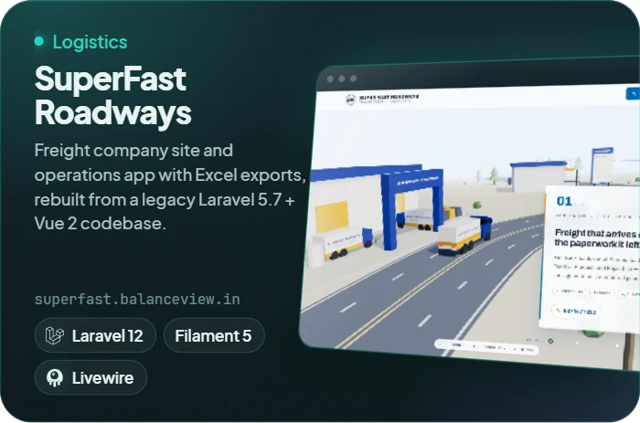</a><a href="https://hdstudio.co.in">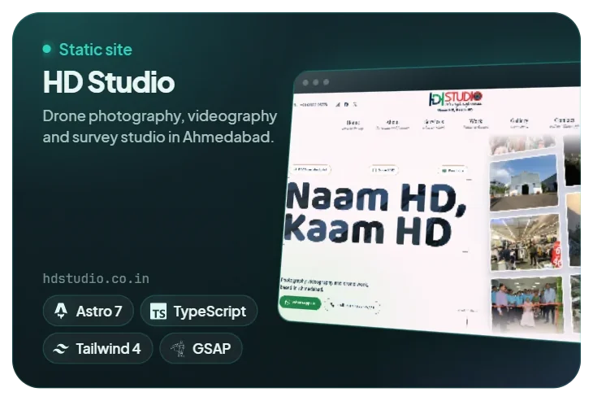</a> <a href="https://grocerystore.balanceview.in">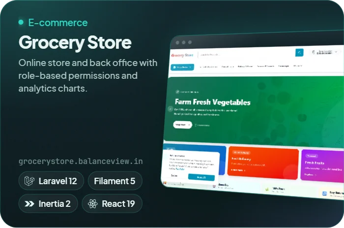</a><a href="https://radiocodess.com">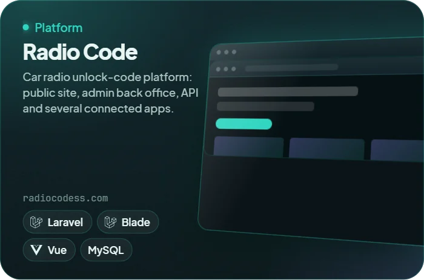</a>

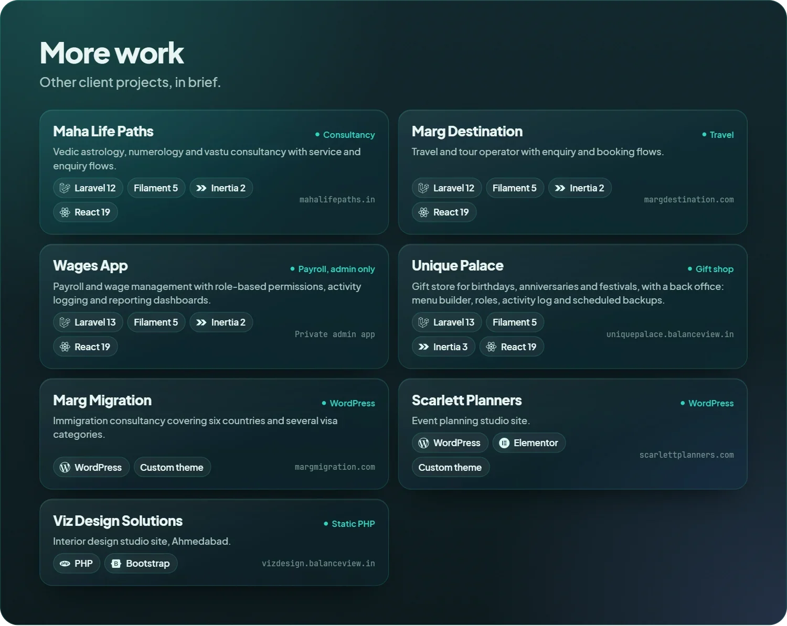

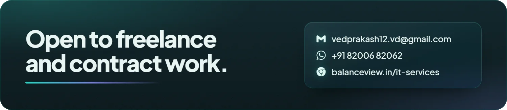
